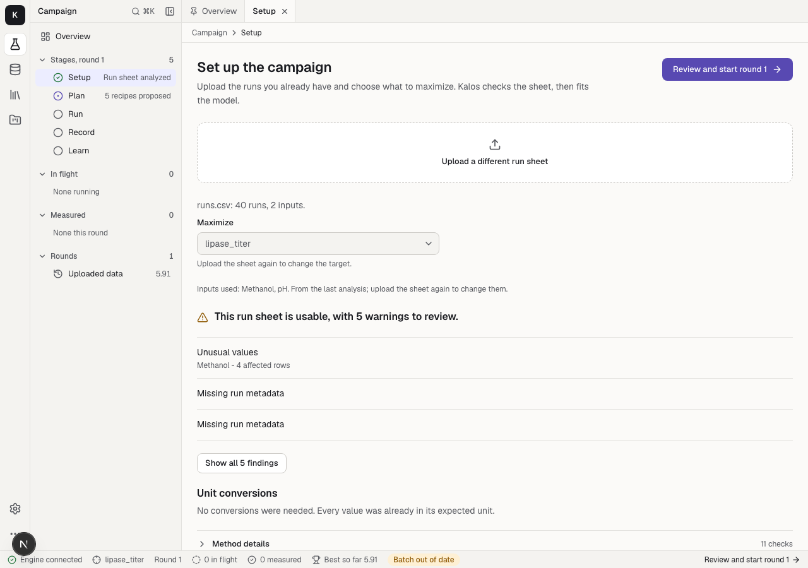
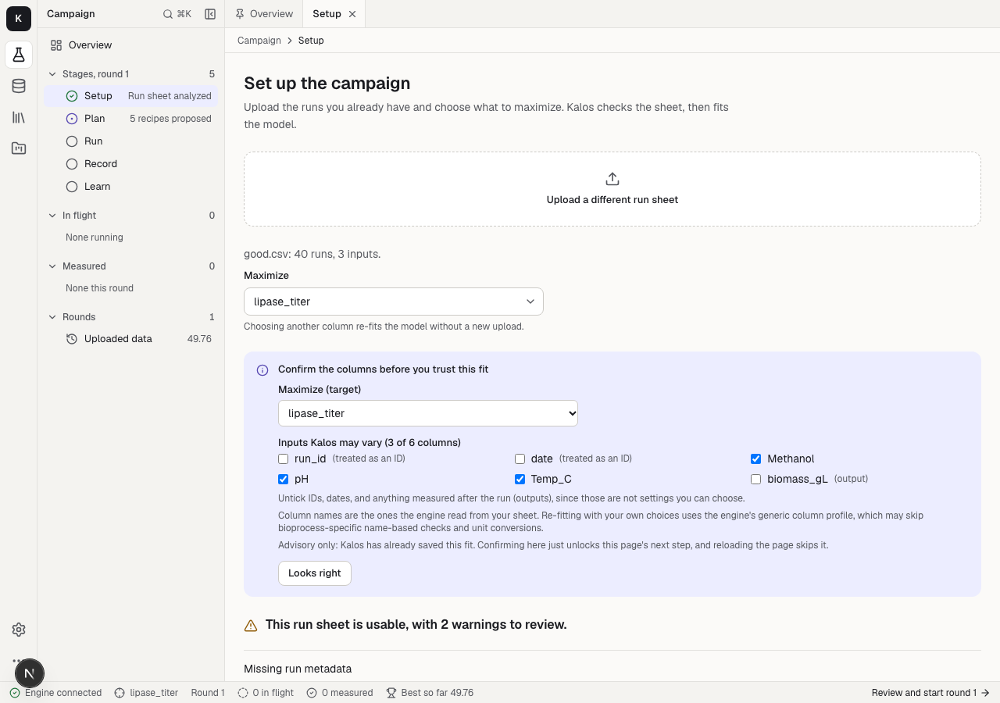
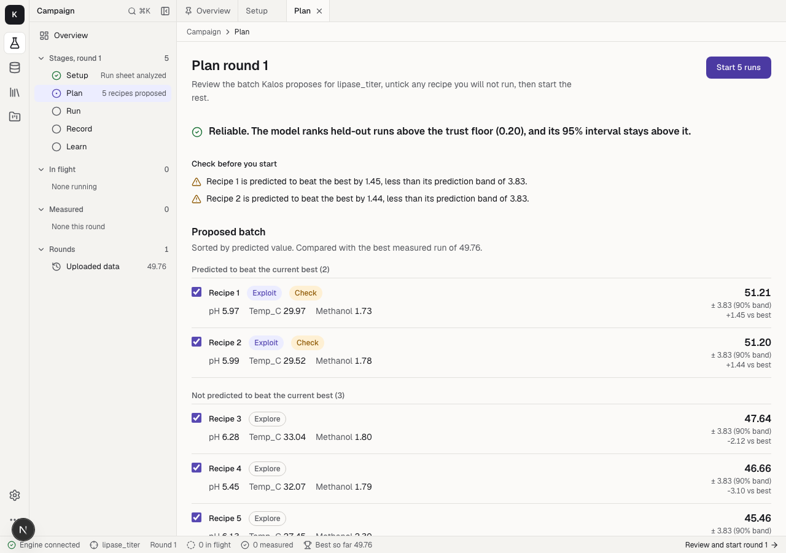
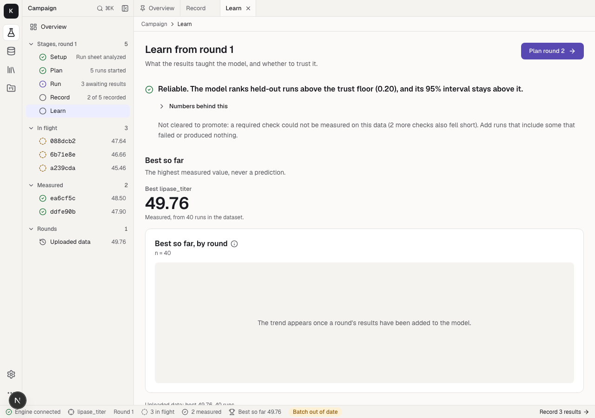
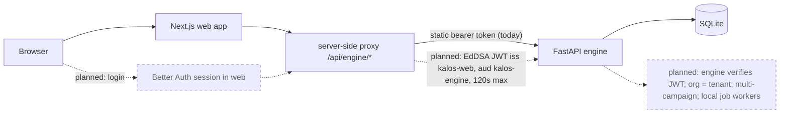

# Kalos web

[](https://github.com/itsbrendandang/kalos-web/actions/workflows/ci.yml)

> **Status: under development. Not a public SaaS.**
> Kalos is a scientific optimization platform being built toward a public SaaS.
> There is no hosted service. **This app has no user login**, and its server-side proxy to the engine is unauthenticated, so it must not be exposed publicly.
> Authentication and organisation management are under development and are not on `main`.
> The optimizer behind it is not scientifically validated (see [Scientific status](#scientific-status)).

## Overview

Kalos web is the scientist-facing workbench for the [Kalos engine](https://github.com/itsbrendandang/kalos-engine), built with Next.js 16 and Tailwind v4.
You upload a run sheet of past bioprocess experiments, choose what to maximize, review a proposed batch of recipes with uncertainty bands and a reliability verdict, record measured results, and plan the next round.
The engine does the modelling; this app presents it and keeps predicted and measured values apart.

Intended users (the product is not available to external users yet): process-development scientists running iterative media or process optimisation campaigns, and small teams that want a propose-measure-re-propose loop with an honest read on model reliability.

## Screenshots

Synthetic demo data from the current development build, not a release. No real or private data is shown.
The column-confirmation view comes from open PR [#65](https://github.com/itsbrendandang/kalos-web/pull/65) and is not on `main` yet.

| Setup | Confirm columns (open PR #65) |
| --- | --- |
|  |  |
| **Plan** | **Learn** |
|  |  |

## Capabilities

**IMPLEMENTED** = on `main` with tests or a verifiable route; **EXPERIMENTAL** = present but demo/seed data or unvalidated; **PLANNED** = not built.
Open PRs are in progress, not implemented.

| Capability | Status | Evidence |
| --- | --- | --- |
| Five-stage campaign workspace (Setup, Plan, Run, Record, Learn) against the live engine | IMPLEMENTED | `app/campaign/*/page.tsx`, `__tests__/stage-pages.test.ts`, `__tests__/campaign-api.test.ts` |
| Upload a run sheet and view the engine's data-quality findings | IMPLEMENTED | `app/campaign/setup/page.tsx`, `__tests__/validation.test.ts` |
| Reliability verdict and uncertainty bands, measured never mixed with predicted | IMPLEMENTED | `lib/api.ts`, `lib/format.ts`, `__tests__/reliability-verdict.test.ts`, `__tests__/workbench.test.ts` |
| Same-origin server-side proxy that attaches the engine bearer token; path allowlist; 120 s timeout | IMPLEMENTED | `app/api/engine/[...path]/route.ts`, `__tests__/engine-proxy.test.ts` |
| Workbench shell: activity rail, explorer, route tabs, status bar, command palette | IMPLEMENTED | `components/`, `__tests__/route-tabs.test.ts` |
| Scale-up readout page, simulator page | IMPLEMENTED (engine-backed; evidence is synthetic) | `app/library/scale-up`, `app/library/simulator`, `__tests__/scale-readout.test.ts` |
| Data registry, Vessels, Plate analysis, Projects | EXPERIMENTAL (fixtures / seed data, badged) | `lib/mock/registry.ts`, `lib/vessel-data.ts`, `lib/plate-data.ts`, `app/projects/data.ts` |
| Fit progress, editable column confirmation, `data_type` counts, edge-of-range flag | in progress, open PR [#65](https://github.com/itsbrendandang/kalos-web/pull/65) | not on `main` |
| Setup correctness fixes: stale analysis, xlsx row types, sheet selector | in progress, open PR [#69](https://github.com/itsbrendandang/kalos-web/pull/69) (stacked on #65) | not on `main` |
| Security headers, Next 16.4.2, no project data in `localStorage` | in progress, open PR [#68](https://github.com/itsbrendandang/kalos-web/pull/68) | not on `main` |
| Provider-neutral session/scope/tenant/JWT-minting building blocks | in progress, open PR [#71](https://github.com/itsbrendandang/kalos-web/pull/71) (stacked on #68); nothing calls them yet | not on `main` |
| `.env` placeholder fix, loopback dev server, repo hygiene | in progress, open PRs [#64](https://github.com/itsbrendandang/kalos-web/pull/64), [#70](https://github.com/itsbrendandang/kalos-web/pull/70), [#67](https://github.com/itsbrendandang/kalos-web/pull/67) | not on `main` |
| User login (Better Auth), sessions | PLANNED | not started on `main` |
| Short-lived EdDSA internal JWT to the engine | PLANNED | helpers in PR #71 only; engine verification not built |
| Organisations as tenants, multiple campaigns | PLANNED | none |
| Server-side storage for projects | PLANNED | none |
| Local job workers / background fits | PLANNED | none |

## Architecture

Solid arrows exist on `main`. Dashed arrows and boxes are planned and not implemented.



The browser never calls the engine directly; it calls the proxy, which attaches the token on the server.
Today the proxy trusts every caller, so anyone who can reach the web app acts as the configured engine token.
Engine-side detail: [`kalos-engine/docs/ARCHITECTURE.md`](https://github.com/itsbrendandang/kalos-engine/blob/docs/readme-saas-status/docs/ARCHITECTURE.md) (on the docs branch until merged).

## What you can do

The app is a workbench.
It has an activity rail, an explorer, a route-per-tab editor, a status bar and a command palette (Cmd+K).

- **Activity rail.** Campaign, Data, Library and Projects, with Settings pinned at the foot.
- **Explorer.** A tree specific to each section, with keyboard navigation.
- **Editor tabs.** Every tab is a route, so deep links, reload and Back all work.
  The open-tab list is a per-viewer convenience kept in `sessionStorage`.
- **Status bar.** Engine connection, round, runs in flight, best so far, and one text action for the next step.
- **Command palette.** Jump to any page or stage, or run an action such as "Upload a run sheet".

The engine runs one live campaign, and the home page is that campaign's workspace.
It moves through five stages, each with one primary action:

| Stage | Route | Primary action |
| --- | --- | --- |
| Setup | `/campaign/setup` | Upload a run sheet, check data quality, choose the target |
| Plan | `/campaign/plan` | Start the proposed batch (for example "Start 5 runs") |
| Run | `/campaign/run` | Record results |
| Record | `/campaign/record` | Save the measured results |
| Learn | `/campaign/learn` | Plan the next round |

The rest of the app:

- **Data** (`/data`): a registry of datasets and runs.
- **Library** (`/library`): Vessels, Plate analysis, Scale-up readout and Simulator, plus a link to Projects.
- **Projects** (`/projects`): client-facing project workspaces on illustrative seed data.
- **Settings** (`/settings`): theme, engine connection, and optional integrations.

Earlier routes redirect permanently (`next.config.ts`), so old links and bookmarks still resolve.

| Old route | Now |
| --- | --- |
| `/decide`, `/optimize` | `/campaign/plan` |
| `/results` | `/campaign/learn` |
| `/analyze`, `/validate` | `/campaign/setup` |
| `/experiments`, `/planning` | `/` |
| `/scale-readout` | `/library/scale-up` |
| `/vessels` | `/library/vessels` |
| `/plate` | `/library/plate` |
| `/simulate` | `/library/simulator` |

## Local development

Start the engine first, from the [kalos-engine](https://github.com/itsbrendandang/kalos-engine) repo, which serves the API on `http://127.0.0.1:8050`:

```bash
python -m kalos.portal
```

Then, in this repo:

```bash
npm install
cp env.example .env.local        # then edit
npm run dev
```

Open `http://localhost:3000`, not `http://127.0.0.1:3000`.
Next 16 dev mode does not treat `127.0.0.1` as the same origin as `localhost`, which can break hot reload and client hydration.

The browser never calls the engine directly.
It calls the same-origin proxy at `/api/engine/*` (`app/api/engine/[...path]/route.ts`), which forwards to the engine and attaches the bearer token on the server.
Configure it in `.env.local` (placeholders in [`env.example`](env.example)):

| Variable | Where | What it does |
| --- | --- | --- |
| `KALOS_ENGINE_URL` | server only | Engine base URL, for example `http://127.0.0.1:8050`. If unset, the proxy answers 502 "engine unreachable". |
| `KALOS_ENGINE_TOKEN` | server only | Bearer token sent to the engine. Leave unset while the engine runs open. Never prefix it with `NEXT_PUBLIC_`. |
| `NEXT_PUBLIC_DEMO_MODE` | build time | Set to `true` to render example data where the engine has none (see below). Default off. |
| `NEXT_PUBLIC_API_URL` | build time | Local-dev escape hatch that points the browser straight at an engine and bypasses the proxy. Do not use it with an engine that requires a token. |

To try the app with data, upload the synthetic example sheet from the engine repo on the Setup stage, or with `curl -F file=@examples/synthetic_bioprocess/synthetic_bioprocess.csv http://127.0.0.1:8050/api/run`.
That sheet is generated, not measured.

Prerequisites: Node 22 (CI pins 22.16.0), npm, and Python 3.10+ for the engine. All tools are free and open source.
The commands `npm ci`, `npm run lint`, `npm run test` (401 tests) and `npm run build` were run clean on this branch's base.

## Proxy routes

The proxy (`app/api/engine/[...path]/route.ts`) forwards GET and POST only, and only for these engine path prefixes: `api/single`, `api/multi`, `api/run`, `api/latest`, `api/campaign`, `api/providers`, `api/scale`.
Anything else returns 404. The engine URL comes only from `KALOS_ENGINE_URL`, never from the request. Only `content-type` and the server-side bearer token are forwarded; only `content-type` and `retry-after` come back.
The engine's own routes, scopes, and tenant scoping are documented in the [engine README]({E}#api).

## Security model

Exists today (`main`):

- The engine token is read from a server-only env var and never shipped to the browser.
- The proxy path allowlist stops it being an open relay; the engine URL is not request-controlled.
- Fonts are self-hosted (no third-party font requests); checked by `__tests__/self-hosted-fonts.test.ts`.

Missing or limited:

- **No user login. The proxy is unauthenticated.** Do not expose this app publicly. The dev server currently binds all interfaces on `main` (loopback bind is in open PR #70).
- No security headers on `main` (CSP, HSTS, frame protections are in open PR #68). Even in that PR, the CSP `script-src` still allows `'unsafe-inline'`.
- On `main`, created projects are stored in the browser's `localStorage` (PR #68 removes this and notes it needs a server store).
- On `main`, the proxy does not cap upload size itself; the engine enforces its own limit (default 25 MB).
- `main` pins `next` 16.2.9; PR #68 bumps it for audit findings. Dev-only `npm audit` findings remain.
- No rate limiting, audit log, or per-user authorisation. Not independently reviewed. No compliance or certification claims.

Report vulnerabilities privately (SECURITY.md is proposed in open PR #67).

## Scientific status

This app displays engine output; it does not validate it.
**The engine's optimizer is not scientifically validated.** Highlights of the engine's own limitations:

- Its synthetic-surface benchmark, including noise-free simulations, is not validation on real processes.
- The hybrid `dataset_0.csv` (mostly synthetic rows) gave a weak pool-replay result (Spearman 0.048).
- The Amii published-media benchmark (engine PR #77) retracted its early "2 faster / 2 slower" summary; a corrected paired test found no detectable difference from random in a smoke run.
- In the mechanistic-prior benchmark (engine PR #81), only the oracle prior survives multiple-comparison correction.

Full details and links: [engine README, Scientific methodology]({E}#scientific-methodology-and-benchmark-limitations) (on the docs branch until merged).
The UI's reliability verdict is a transparent rule on the engine's held-out metrics, not a guarantee.

## Current limitations

- One live campaign; no multi-user or multi-organisation support.
- Data, Vessels, Plate and Projects are fixtures or seed data.
- Everything the UI can do depends on a running engine; there is no offline mode.
- A few older pages still show internal engine vocabulary.

## Roadmap

- **MVP (toward a public beta):** IMPLEMENTED: campaign workspace, proxy. IN PROGRESS: PRs #64, #65, #67, #68, #69, #70, #71. PLANNED: Better Auth login, short-lived JWT to the engine, organisations as tenants, server-side project storage, multiple campaigns, local job workers.
- **Later (PLANNED):** richer plate and vessel tools on real data, external security review, validation of the optimizer on independent real data.

## $0 stack

Next.js, React, Tailwind, Base UI, Recharts, Vitest, GitHub Actions, and a local engine with SQLite. Local development needs no paid service or API key.

## Honest by design in the UI

Each rule names the file that carries it.

- One reliability verdict app-wide ("Reliable", "Not yet reliable", "Not enough data"), computed in one place: `reliabilityVerdict` in `lib/api.ts`, tested in `__tests__/reliability-verdict.test.ts`.
- One uncertainty band per recipe, shown with its coverage: `formatBand` in `lib/format.ts`.
- Measured and predicted values are never mixed.
  Best so far comes from the campaign's measured results, never a prediction: `lib/workbench.ts`, `__tests__/workbench.test.ts`.
- Demo data wears a visible "Example data" badge, and demo content renders only when `NEXT_PUBLIC_DEMO_MODE=true`: `ExampleBadge` in `components/ui/badge.tsx`, `lib/demo.ts`.
- State is never carried by color alone.
  Status colors pair with a word or icon, and text and UI color pairs are checked for WCAG contrast in both themes: `__tests__/contrast.test.ts`.
- No side-stripe borders on callouts or cards: `__tests__/design-guards.test.ts`.
- No engine vocabulary in copy.
  This is a design rule (see `DESIGN.md`), not a test, and a few older pages still show internal names.

## Live vs demo data

| Route | Source |
| --- | --- |
| `/`, `/campaign/*` | Engine (`/api/latest`, `/api/campaign*`). With demo mode on and no campaign yet, `/` and `/campaign/run` show a badged example campaign from `lib/mock/campaign.ts`. |
| `/library/scale-up` | Engine (`POST /api/scale/readout`). Disabled in demo mode. |
| `/library/simulator` | Engine (`/api/single`, `/api/multi`), which runs a synthetic benchmark surface. |
| `/settings` | Engine (`/api/providers`, and the connection check). |
| `/data` | Fixtures in `lib/mock/registry.ts`, synthetic, shown only in demo mode. |
| `/library/vessels` | Fixtures in `lib/vessel-data.ts`, a seeded simulation, shown only in demo mode. |
| `/library/plate` | Fixtures in `lib/plate-data.ts`, a seeded simulation, always shown with a demo badge. |
| `/projects/*` | Illustrative seed data in `app/projects/data.ts`, saved per viewer in the browser. One project scores the live engine analysis. |


## Design system

- Geist and Geist Mono, self-hosted with `next/font/local` (no Google Fonts requests, enforced by `__tests__/self-hosted-fonts.test.ts`).
- Light first, with full dark mode.
- OKLCH tokens defined once in `app/globals.css`, exposed through Tailwind v4 `@theme inline`.
- shadcn/ui primitives on Base UI in `components/ui/`, shared pieces in `components/kit/`.
- Charts and KPI visuals adapted from [Tremor](https://github.com/tremorlabs/tremor) (Apache-2.0) in `components/tremor/`.

[`DESIGN.md`](DESIGN.md) has the token reference, type scale and layout rules.

## Development and CI

CI (`.github/workflows/ci.yml`, Node 22.16.0) runs these on every push and pull request:

```bash
npm ci
npm run lint
npm run test
npm run build
```

`npm run build` is also the type-check gate; there is no separate `tsc` step (the workflow explains why).

## Deploy

This repo has its own [`Dockerfile`](Dockerfile): a multi-stage build on `node:22-alpine` that runs the Next.js standalone output as a non-root user, with a health check.
The compose stack that runs the engine, this app and a backup sidecar together lives in the engine repo, and its [`deploy/RUNBOOK.md`]({E}/blob/main/deploy/RUNBOOK.md) has the quickstart, the security checklist and the backup drills.
Because there is no login, deploy only on a private network.

## Contributing

- Run the CI commands above and make sure all three are green.
- Conventional commits (`feat:`, `fix:`, `docs:`, `chore:`); one focused pull request per change.
- PR descriptions should cover: what is implemented, incomplete, tests, security, dependencies, required before merge.
- Use synthetic data in tests and screenshots. Never commit secrets, tokens, or customer data.
- Next.js 16 differs from older versions; read the relevant guide in `node_modules/next/dist/docs/` before changing framework-level code.

## Third-party

- Geist and Geist Mono are licensed under the SIL Open Font License 1.1: [`app/fonts/GEIST-LICENSE.txt`](app/fonts/GEIST-LICENSE.txt).
- The files in `components/tremor/` are adapted from Tremor under Apache-2.0: [`components/tremor/NOTICE`](components/tremor/NOTICE).

## License

Apache-2.0.
See [`LICENSE`](LICENSE).

## About the author

Brendan Dang.
Founder-operator in biotech process optimization, now an ML engineer.
[github.com/itsbrendandang](https://github.com/itsbrendandang)
