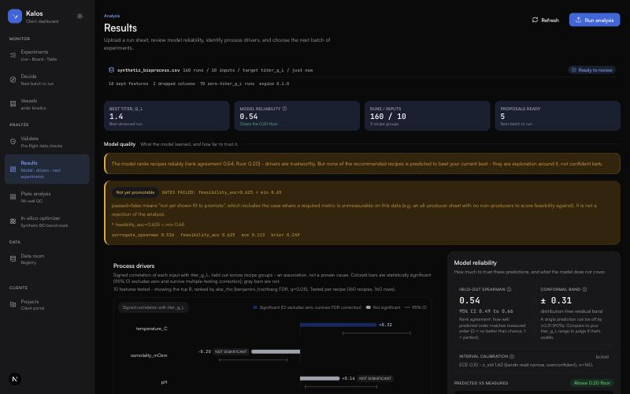

# Kalos web

[](https://github.com/itsbrendandang/kalos-web/actions/workflows/ci.yml)

The production front end for [Kalos](https://github.com/itsbrendandang/kalos) - a
Bayesian-optimization platform for bioprocess development. Next.js 16 + Tailwind v4,
on a single unified blue design system, consuming the Kalos engine API.



The Results view above is a real run against `examples/synthetic_bioprocess.csv`
in the engine repo, not a mock - the "GATES FAILED" badge is the honesty gate
(`docs/HARDENING.md` in the engine repo) refusing to promote a model that
has not actually cleared its feasibility bar, exactly as it would for real data.

## Contents

- [Views](#views)
- [Design system](#design-system)
- [Voyager surface](#voyager-surface)
- [Run it](#run-it)
- [Testing](#testing)
- [Production deployment](#production-deployment)
- [Stack](#stack)

## Views

- **Experiments** (`/`) - the single hub for planning, running, and tracking every
  experiment.
  A Live / Board / Table view switcher sits under the header, driven by the
  `?view=live|board|table` search param (default `live`), so each view is
  directly linkable and the back button moves between them.
  - **Live** (`?view=live`) - the operations view: summary tiles, in-flight run
    cards (attention-needed first), the next batch to run, and recently
    completed runs.
  - **Board** (`?view=board`) - a Kanban board of experiment/planning tasks
    moving through To Do -> Draft -> In Progress -> Review Requested ->
    Completed, with a Table sub-view (the same tasks grouped by column) and a
    Gantt sub-view stub ("coming soon"), switched via the same toolbar. Cards
    drag between columns via native HTML5 drag-and-drop (no added dependency);
    a lightweight inline input adds a new card to a column without a modal.
    Task data is a static mock in `lib/mock/planning.ts`, pending a real
    task/experiment-status source.
  - **Table** (`?view=table`) - the real experiment queue wired to the Kalos
    portal: upload a run sheet, flag it ready, and run the engine on demand or
    for every ready experiment at once.
- **Results** (`/results`) - your last analyzed dataset at a glance: model
  reliability (honest held-out rank correlation + 95% CI), what drives the
  outcome, predicted-vs-measured, a run landscape (a low-dimensional
  projection of every run, positioned by recipe similarity and colored by
  target - only shown when the engine returns an `embedding`), a histogram of
  measured target values with non-producers called out, and Recommended
  actions - the optimizer's next-best experiments, ranked by the acquisition
  function (`#next-experiments`; this is where the old standalone Optimize
  page folded in). Reads `GET /api/latest`; shows an upload prompt until you
  analyze a dataset (it is not a demo).
- **Decide** (`/decide`) - the decision cockpit and the closed optimization loop.
  The recommended batch is the hero (each experiment's recipe, predicted value +
  uncertainty, and why); the honest reliability verdict is a compact chip. Queue
  proposals and Start them, log each run's measured outcome, then Re-propose -
  which folds the results into the dataset and returns the next batch, with a
  best-so-far progress chart. Wired to the engine's `/api/campaign*` endpoints
  (see `docs/CAMPAIGN_LOOP.md` in the engine repo); best-so-far and round come
  from the live campaign, never a prediction. Below the loop, a **scale-up
  timeline** projects the path from 96-well plate to production vessels across
  branching multi-objective paths (max-yield / min-cost / fastest), with
  confidence bands that widen with scale - clearly labeled "projected" (physics/
  literature priors, not measured; `lib/scaleup-projection.ts`). Diagnostics
  (drivers, reliability, run structure, predicted landscape) collapse behind
  lazy-mounted disclosures, and a "Coming next" section names what unlocks with
  live process data. Full design + honesty tiers in `docs/DECIDE_COCKPIT.md`.
- **Analyze** (`/analyze`) - drop a CSV/TSV/Excel run sheet; the engine fits,
  cross-validates honestly, ranks the drivers, and recommends the next batch.
  Reached via the "Run analysis" action button on the Experiments hub and on
  Results, not a standalone nav entry.
- **Validate** (`/validate`) - drop a run sheet and see only the data-quality
  verdict, before committing to a full optimization run. Renders the engine's
  `validation` block: a pass / pass-with-warnings / fail header, per-check
  findings with errors first, the affected columns and row indices (honestly
  captioned "showing 20 of N" when the engine's row list is capped), and a
  unit-conversions section naming exactly what was changed about the upload and
  what it was converted to. Also shows external-provider credential status from
  `GET /api/providers`, framed neutrally - an unconfigured provider is a
  documented optional upgrade, not an error. Severity is never conveyed by color
  alone.
- **Data** (`/data`) - the data catalog: every dataset and run under a stable,
  anonymized barcode, with a searchable/sortable registry table and a
  per-dataset drill-down (sample runs, output ranges, provenance). Mock
  registry data lives in `lib/mock/registry.ts` (`DATASETS` and
  `RUNS_BY_DATASET`).

The old `/planning`, `/experiments`, and `/optimize` routes redirect to
`/?view=board`, `/?view=table`, and `/results#next-experiments` respectively,
so existing links and bookmarks still resolve.

## Design system

The whole app, optimizer surface and Voyager product surface alike, shares one
unified blue design system. Tokens (color, radius, type) are defined once in
`app/globals.css` and consumed everywhere via Tailwind v4's `@theme inline`.
See `DESIGN.md` at the repo root for the full token reference, color roles,
and type scale.

Primitives come from **shadcn/ui** on `@base-ui/react`, configured in
`components.json` and living in `components/ui/`. They are the mechanism, not
the design: every primitive is mapped onto the kalos tokens above rather than
shadcn's default neutral theme, so the app does not read as a stock admin
template. Two rules matter when adding one:

- **Two separate data-color families.** `--chart-1..5` is a single-hue blue
  sequential ramp for ORDERED MAGNITUDE (heatmaps, the plate grid) and reverses
  lightness in dark mode so "more" stays "more visible". `--series-1..6` is the
  Okabe-Ito colorblind-safe qualitative palette for UNORDERED CATEGORIES
  (per-vessel kinetics). Never use one for the other's job. Because
  `--series-*` alone cannot carry meaning in greyscale, categorical traces also
  need a dash pattern or a direct label.
- **Patch `bg-muted` out of anything fetched from the registry.** In this
  codebase `--muted` is a TEXT gray with 250+ call sites, not shadcn's subtle
  surface, so a stock primitive using `bg-muted` renders a near-invisible fill.
  Rewrite it to `bg-secondary` or `bg-blue-soft`. `DESIGN.md` records this as a
  required step.

Note that `npx shadcn add` currently hangs with no output in this environment;
`DESIGN.md` documents the direct-registry workaround.

## Voyager surface

A customer-facing product surface lives under `/voyager`, with its own
top-nav chrome and a denser layout than the rest of the app. It shares the
same blue tokens as the optimizer surface (aliased in `app/voyager/voyager.css`
under `.voyager-root`) and renders in Satoshi, the original prototype's
typeface, self-hosted via `next/font/local`; see `DESIGN.md` for the token
reference. The optimizer sidebar is bypassed for these routes in
`components/app-shell.tsx`.

- **`/voyager`** - Projects home: customers and their projects, each tagged by
  workflow stage. Add/Edit customer and project modals open here.
- **`/voyager/projects/[id]`** - project workspace with three tabs:
  - **Phase 1** - the iterative DoE/Bayesian-opt loop as iteration cards
    (LHS then BO Explore/Exploit), batch-ticket upload, and unlock gating.
  - **Phase 2** - scale-up: either the setup state (config + 9-stage pipeline) or
    the run results with Promote/Hold candidate cards (drivers, scale-up
    projection, warnings) alongside the completed pipeline. These are illustrative
    and carry a persistent "Sample data - illustrative, not a real analysis"
    banner (same on Phase 1 and the final report) so fabricated numbers are never
    mistaken for real engine output.
  - **Phase 2 (live)** - the "Bioqore R&D" project (`live: true`) scores the real
    uploaded dataset through the engine via `GET /api/latest`: recommended next
    experiments (recipe + predicted target with a distribution-free conformal
    band), honest model reliability (grouped-CV Spearman + CI vs the 0.20 floor),
    global signed drivers, and an explicit "not modeled" callout (success
    probability, calibration, scale-up transfer). Falls back to a start-the-engine
    notice when the API is unreachable.
  - **Linkage tree** - an interactive SVG experiment lineage (Phase 1 and
    Phase 1+2) with a clickable per-node detail panel.
- **`/voyager/projects/[id]/report`** - the final report: stat cards, drivers and
  ideal ranges, scale-up projection curve, candidate decisions, and export.

Seed data lives in `app/voyager/data.ts`. The engine does not yet expose a
customers/projects API, so these screens are illustrative and do not call it;
the types are shaped so a real API can drop in without touching the views.
The completed-projects home variant is not yet wired.

## Run it

The engine API must be running first (in the `kalos` repo):

```bash
python -m kalos.portal        # serves the API on http://127.0.0.1:8050 (CORS-enabled)
```

Then the web app:

```bash
npm install
npm run dev                    # http://localhost:3000
```

By default, the app never talks to the engine directly from the browser. It
calls the same-origin proxy at `/api/engine/*`
(`app/api/engine/[...path]/route.ts`), which forwards to `KALOS_ENGINE_URL`
and attaches `Authorization: Bearer ${KALOS_ENGINE_TOKEN}` server-side - see
that file's header comment for why a bearer token can never live in
client-visible code. Set both in `.env.local` (see `env.example`); with
neither set the proxy forwards to `http://127.0.0.1:8050` with no auth
header, matching the engine's own open-mode default.

Escape hatch for local dev: set `NEXT_PUBLIC_API_URL` in `.env.local` to
point the browser straight at an engine, bypassing the proxy entirely. Only
use this against an engine with no auth configured - it is not the deployed
posture.

## Testing

```bash
npm run lint    # eslint
npm run test    # vitest - 182 tests as of this writing
npm run build   # next build; also the typecheck gate (see ci.yml's comment
                 # on why there is no separate `tsc --noEmit` step)
```

All three run in CI (`.github/workflows/ci.yml`) on every push and PR.

## Production deployment

The deploy pack (Docker images for the engine, this app, and a SQLite
backup sidecar; one published front door; `docker compose`) lives in the
engine repo at
[`kalos/deploy/`](https://github.com/itsbrendandang/kalos/tree/main/deploy).
See that repo's
[`deploy/RUNBOOK.md`](https://github.com/itsbrendandang/kalos/blob/main/deploy/RUNBOOK.md)
for the verified quickstart, the security checklist, and backup/restore
drills - it documents real numbers from an actual run, not a plan.

## Stack

Next.js 16 (App Router, Turbopack), Tailwind v4, recharts, lucide-react.
Design tokens and rules live in `app/globals.css`; see `DESIGN.md` for the
full reference.
